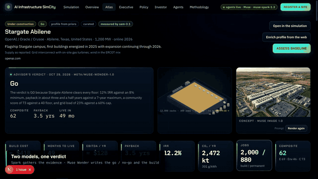

# AI Infrastructure SimCity

A playable world for siting AI data centers, backed by a live registry and a
set of research and advisory agents, built on Muse by Meta.



Live at [ai-infrastructure-simcity-dev-rel-eng.vercel.app](https://ai-infrastructure-simcity-dev-rel-eng.vercel.app).

- **Simulation** (`/`): spin the globe, pick any of the modeled regions or any
  tracked real site (amber diamonds), spec a facility with a GPU fleet mix
  (H100, B200, GB300, next-gen) and a people-versus-robots crew, break ground,
  and dive into a navigable 3D site. Every rack in every row carries its
  servers as they are installed; busways, liquid-cooling loops, CDUs, PDUs,
  CRAH units, chillers, cooling towers, generators and the electrical room
  arrive with the fit-out. Once live, technicians and inspection robots walk
  the aisles. Any rack can be opened; a thermal view shows the heat.
- **Registry and dossiers** (`/atlas`, `/sites/[id]`): every current and
  announced facility the agents have found, with sources, a region profile,
  a deterministic estimate, an energy what-if mixer and the advisor's verdict.
- **Advisor** (Muse Wonder) issues go / conditional / no-go and writes a **build plan**
  (supply mix, hardware, crew, automation, phasing, community commitments)
  that opens directly in the simulation with one click.
- **Executive, Policy and Investor** views recompute the whole portfolio in
  the browser from sliders: crew and automation, carbon price and transmission
  headroom, power price, firmness, GPU-hour rates and discount rate.

## Stack

- Next.js 15 (App Router, TypeScript), Tailwind 4, Recharts, Leaflet, three.js
- Prisma 6 on Postgres
- **Muse by Meta** through the Meta Model API, with Crusoe Cloud managed
  inference (Kimi, GLM 5.3) as the fallback and Tavily as the backup search

## Built on Muse

Four Meta models do distinct jobs. Set `MODEL_API_KEY_MUSE` and all of them are live.

| Model | Job in the app | Where |
|---|---|---|
| **Muse Spark** | Research and extraction for discovery and enrichment, the chat planner, and web search through search grounding (Tavily is the backup) | `src/lib/agents/research.ts`, `discover.ts`, `enrich.ts`, `planner.ts`, `src/lib/search/grounded.ts` |
| **Muse Wonder** | The final word: reads the engine's verdict and Spark's findings and writes the rationale, conditions, risks and the build plan | `src/lib/agents/assess.ts` |
| **SAM 3.1** | Measures a site from satellite imagery, buildings, open land, water and solar, and feeds the hectares into the estimate. Measures what the basemap shows: tiles often trail construction, so the figures are most trustworthy for proposed sites (see the methodology page for the Abilene check) | `src/lib/vision/sam.ts`, `/api/vision/measure` |
| **Muse Image** | A photoreal concept render of the facility the spec describes, in the landscape SAM measured | `src/lib/vision/render.ts`, `/api/vision/render` |

Spark gathers, Wonder decides, SAM looks, Image shows.

## Run it

```bash
# 1. Postgres (any Postgres 14+ works; this starts one in Docker on port 5433)
docker run -d --name atlas-pg -e POSTGRES_USER=atlas -e POSTGRES_PASSWORD=atlas \
  -e POSTGRES_DB=atlas -p 5433:5432 postgres:16-alpine

# 2. Dependencies and schema
npm install
npm run db:generate
npm run db:push

# 3. Curated starting registry (24 well-reported campuses)
npm run db:seed

# 4. Dev server on http://localhost:3100
npm run dev
```

Copy `env.example` to `.env` and set `MODEL_API_KEY_MUSE` (a Meta Model API
key) and `TAVILY_API_KEY` to put the agents in live mode on Muse. Search
grounding runs the web searches on Spark; Tavily is the backup engine. Setting
`CRUSOE_API_KEY` as well gives the agents a fallback provider, and
`LLM_PROVIDER=crusoe` makes Crusoe primary; its model hints (`kimi`, `glm`) are
resolved against the endpoint's `/v1/models` list at first use. Without any
inference key the app runs in **fixture mode**: discovery returns sample
records, enrichment keeps country priors, and the advisor writes a templated
narrative and plan around the deterministic verdict. The header shows which
mode and which model are on, and `/api/agents/health` reports both providers.

`DATABASE_URL` defaults to the Docker container above when unset.

## Pages

| Route | What it does |
|---|---|
| `/` | The simulation. `?site=<id>` focuses a tracked site; `&plan=<assessmentId>` loads the advisor's plan and breaks ground |
| `/overview` | Headline counts, audience entry points, how a verdict is produced |
| `/atlas` | Map and sortable table with live filters by status, verdict, country, size and text |
| `/sites/[id]` | Dossier: sources, region profile, estimate, what-if mixer, scenarios, verdict, build plan |
| `/sites/new` | Register a proposal by hand |
| `/executive` | Portfolio board with crew, automation and GPU sliders applied across all sites |
| `/policy` | Impact board with country chips, carbon price and transmission sliders |
| `/investor` | IRR / NPV board with power, firmness, GPU price and discount sliders |
| `/agents` | Discovery console and the full run log |
| `/methodology` | Every coefficient, floor and assumption |

## Agents

- **Discovery** (`src/lib/agents/discover.ts`): Spark plans the searches,
  search grounding runs them, Spark extracts structured records with source
  numbers. Records that name a tracked facility differently are merged by
  normalized name, or by operator or distinctive name words within 25 km.
- **Enrichment** (`src/lib/agents/enrich.ts`): targeted searches on power
  price, grid carbon and headroom, interconnection, labor, land, water,
  population and sentiment; writes sourced values into the region profile,
  then SAM 3.1 measures the site itself.
- **Advisor** (`src/lib/agents/assess.ts`): the engine searches eleven energy
  mixes against the viability floors and fixes the verdict; Muse Wonder writes
  the rationale, conditions, risks, a brief per audience and the build plan.
- **Planner** (`src/lib/agents/planner.ts`): a chat on Spark that turns a
  request into a site, a spec and a supply mix, and opens it in the simulation.

Every run is recorded in `AgentRun` with its log, output, model and tokens.

## Model and simulation

`src/lib/model/estimate.ts` is the engine; `energy.ts`, `hardware.ts` and
`regions.ts` hold the coefficients and priors; `optimize.ts` the floors and the
mix search. `src/sim/` is the simulation: `sim.js` (globe, economy, events,
scoring), `site3d.js` (three.js campus, data hall, electrical room, thermal
view). Real sites enter the sim as regions built from their profile, scaled to
their first 150 MW phase. These are screening-grade numbers, not engineering or
investment advice.

## Maintenance scripts

```bash
npx tsx scripts/reestimate.ts   # recompute every scenario after a model change
npx tsx scripts/assess-all.ts   # run the advisor on every baseline
```

## Deploying

See [DEPLOY.md](DEPLOY.md) for hosting on Vercel with a hosted Postgres.

## License

MIT. See [LICENSE](LICENSE).
